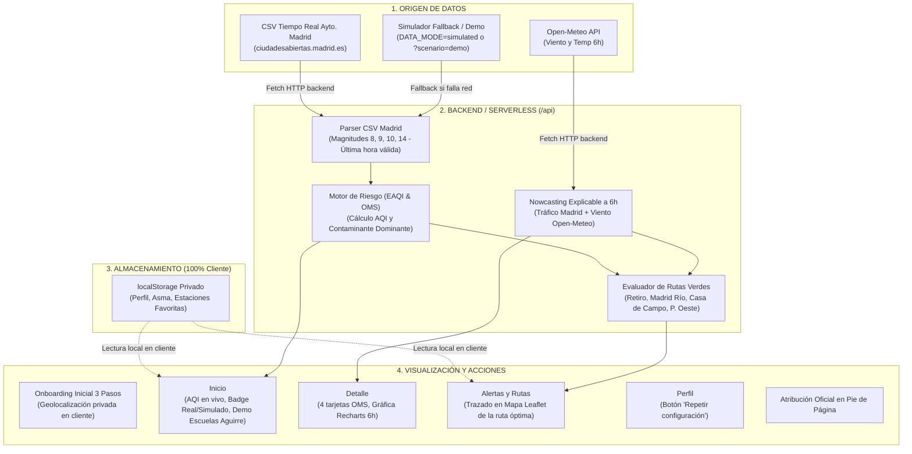

# AireVecinal 🍃🏙️ (Madrid)

**AireVecinal** es una aplicación web orientada a la **Sostenibilidad y el Medio Ambiente**, diseñada exclusivamente para la ciudad de **Madrid**. Conecta directamente con la Red de Vigilancia de Calidad del Aire del Ayuntamiento de Madrid y con la API meteorológica Open-Meteo para avisar a los vecinos cuando existe riesgo de alta contaminación y recomendar la mejor de las 4 rutas verdes protegidas de la ciudad.

---

## 1. Características Principales

- **Exclusivo para Madrid:** Las zonas corresponden a las **24 estaciones oficiales de control de calidad del aire** del Ayuntamiento de Madrid (dataset `212629-0-estaciones-control-aire`).
- **Datos en tiempo real:** Lectura y procesado del CSV horario oficial de datos abiertos (`ciudadesabiertas.madrid.es`, dataset `212531-0-calidad-aire-tiempo-real`). Se extraen los valores de la última hora válida para $\text{NO}_2$ (magnitud 8), $\text{PM}_{2.5}$ (magnitud 9), $\text{PM}_{10}$ (magnitud 10) y $\text{O}_3$ (magnitud 14).
- **Fallback resiliente:** Si la fuente municipal no responde o está en mantenimiento, la app conmuta automáticamente a simulación urbana realista indicando la etiqueta *"Datos simulados"*.
- **Previsión y meteorología (Open-Meteo):** Predicción horaria a 6 horas, temperatura y velocidad del viento a 10m sin necesidad de claves de API.
- **Las 4 Rutas Verdes de Madrid:**
  1. **El Retiro** (estación más cercana: Parque del Retiro / Escuelas Aguirre).
  2. **Madrid Río** (estación más cercana: Farolillo / Arganzuela).
  3. **Casa de Campo** (estación más cercana: Casa de Campo).
  4. **Parque del Oeste** (estación más cercana: Plaza de España / Moncloa).
  *El motor de riesgo evalúa el índice previsto en cada entorno y recomienda automáticamente la ruta más limpia.*
- **Onboarding sin login:** Asistente inicial en 3 pasos (Bienvenida, Perfil de Sensibilidad, Estación de Referencia con botón *"Usar mi ubicación"* que calcula la estación más cercana en el navegador mediante Haversine). **100% privado:** la ubicación nunca se envía a ningún servidor y las preferencias se guardan solo en `localStorage` (con `try/catch`).
- **Preparado para Vercel:** Backend adaptado a funciones serverless en `/api` (`zones`, `air-quality`, `forecast`, `recommendations`) sin escritura en disco.

---

## 2. Stack Tecnológico

- **Frontend:** React 19, TypeScript estricto (sin `any`), Tailwind CSS v4, React Router v7, Leaflet (`react-leaflet`), Recharts, Lucide React.
- **Backend & Serverless:** Funciones serverless en `/api` para Vercel + servidor Express en `/server` para desarrollo local con `tsx`.
- **Testing:** Vitest (9 pruebas unitarias automatizadas del motor de riesgo).
- **Herramientas:** Concurrently (`npm run dev`), ESLint.

---

## 3. Arquitectura y Flujo de Datos



---

## 4. Instalación y Ejecución Local

### Prerrequisitos
- Node.js $\ge$ 18.
- npm $\ge$ 9.

### Puesta en marcha
```bash
# 1. Instalar dependencias
npm install
npm --prefix server install

# 2. Arrancar en desarrollo (Frontend en :5173 y Backend en :3001 con proxy)
npm run dev
```

### Otros scripts
- **Compilar cliente y servidor:** `npm run build && npm run build:server`
- **Ejecutar tests unitarios (Vitest):** `npm test`
- **Verificar linter (ESLint):** `npm run lint`

---

## 5. Despliegue en Vercel

Sigue la guía detallada en [`DEPLOY.md`](DEPLOY.md). Resumen:
1. Conecta el repositorio en [Vercel](https://vercel.com).
2. Framework: `Vite`. Carpeta de salida: `dist`.
3. Variable de entorno opcional: `DATA_MODE=real` *(por defecto)* o `DATA_MODE=simulated`.

---

## 6. Demostración Interactiva (Escuelas Aguirre)

1. Abre la aplicación en `http://localhost:5173`.
2. En la pantalla de **Inicio**, haz clic en el botón superior **"Simular episodio"**.
3. **Resultado:**
   - La estación cambia automáticamente a **Escuelas Aguirre** (junto al Retiro).
   - Se inyectan los valores del episodio: $\text{NO}_2 = 130\,\mu\text{g/m}^3$, $\text{PM}_{2.5} = 45\,\mu\text{g/m}^3$, viento en calma ($3.2\,\text{km/h}$).
   - Nivel: **Malo** (AQI 140, color rojo).
   - Notificación emergente:
     > *"Riesgo alto en tu zona de 18:00 a 21:00. Evita correr hoy; si sales, usa la ruta por el Retiro (índice Bueno)."*
   - En **Alertas**, la **Ruta por el Retiro** queda seleccionada y trazada en verde esmeralda sobre el mapa Leaflet con un 55% de reducción en exposición.

---

## 7. Atribución de Datos Oficiales

- **Calidad del aire:** Ayuntamiento de Madrid – datos abiertos (licencia CC BY 4.0).
- **Previsión meteorológica y viento:** Open-Meteo API.
