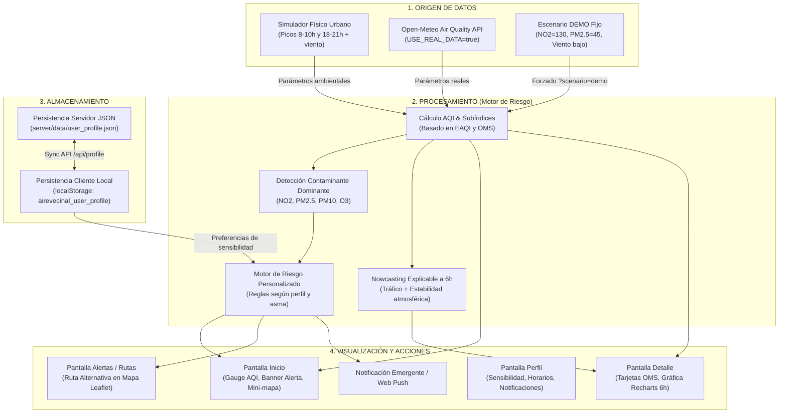

# AireVecinal 🍃🏙️

**AireVecinal** es una aplicación web comunitaria orientada a la **Sostenibilidad y el Medio Ambiente**, diseñada para avisar a los vecinos cuando existe riesgo de mala calidad del aire en su zona y recomendar acciones preventivas (como reducir el ejercicio intenso o seguir una ruta verde alternativa con menor concentración de contaminantes).

---

## 1. Contexto del Producto

- **Pilar:** Sostenibilidad, Salud Ambiental y Movilidad Urbana Saludable.
- **Usuario objetivo:** Vecinos especialmente vulnerables o expuestos a la contaminación urbana: deportistas (*runners*, ciclistas), familias con niños pequeños, personas mayores y vecinos con patologías respiratorias o asma.
- **Caso de uso real:** Marta sale a correr cada tarde por su barrio (Chamartín / Eje Castellana en Madrid). Un día laborable con tráfico denso y viento en calma, los niveles de dióxido de nitrógeno ($\text{NO}_2$) y partículas finas ($\text{PM}_{2.5}$) se disparan durante la hora punta vespertina. La app le envía una alerta:
  > *"Riesgo alto en tu zona de 18:00 a 21:00. Evita correr hoy; si sales, usa la ruta por el parque interior (índice 'Bueno')."*
- **Entorno geográfico de ejemplo:** Barrios residenciales y avenidas principales de **Madrid** (Chamartín - Castellana, Retiro - Menéndez Pelayo, Chamberí, Madrid Río, Dehesa de la Villa).

---

## 2. Stack Tecnológico

- **Frontend:**
  - React 19 + TypeScript (modo estricto, sin `any`).
  - Vite con proxy inverso para `/api`.
  - React Router para navegación SPA móvil (4 pantallas fijas con barra inferior).
  - Tailwind CSS v4 para diseño limpio, accesible y contraste semántico (AA).
  - Leaflet (`react-leaflet`) para visualización geográfica interactiva de zonas y rutas protegidas.
  - Recharts para gráficas de previsión horaria a 6 horas.
  - Lucide React para iconografía accesible (no depende únicamente del color).
- **Backend:**
  - Node.js + Express en TypeScript en `/server`, con su propio `package.json` y `tsx`.
  - CORS habilitado.
  - Motor de riesgo (`riskEngine.ts`) con cálculo del índice europeo de calidad del aire (EAQI), detección de contaminante dominante y modelo explicable de *nowcasting*.
  - Simulador de picos de tráfico urbano y factor de viento (`simulator.ts`), con integración opcional a la API pública de **Open-Meteo Air Quality**.
  - Persistencia híbrida en memoria y archivo JSON (`server/data/user_profile.json`), combinada con `localStorage` en el cliente.
- **Testing & Herramientas:**
  - Concurrently para arranque unificado con `npm run dev`.
  - Vitest para suite completa de pruebas unitarias del motor de riesgo.

---

## 3. Arquitectura y Flujo de Datos

El sistema opera bajo un flujo desacoplado de 4 etapas: **Origen → Procesamiento → Almacenamiento → Visualización / Acciones**.



### Detalle de cada bloque:
1. **Origen:**
   - **Simulación realista:** Genera concentraciones urbanas con elevaciones en horas punta (8:00–10:00 y 18:00–21:00) y reduce la dispersión si la velocidad del viento es baja.
   - **Open-Meteo:** Conexión directa opcional a `https://air-quality-api.open-meteo.com` sin requerir clave de API.
   - **Escenario Demo:** Forzable mediante `?scenario=demo` con datos exactos de episodio crítico ($\text{NO}_2 = 130\,\mu\text{g/m}^3$, $\text{PM}_{2.5} = 45\,\mu\text{g/m}^3$).
2. **Procesamiento (Motor de Riesgo en `/server/src/services/riskEngine.ts`):**
   - Transforma concentraciones brutas a subíndices normalizados (0-200) según umbrales del Índice Europeo de Calidad del Aire (EAQI).
   - Identifica el contaminante dominante que marca el índice global.
   - Aplica matriz de riesgo cruzando AQI y perfil de sensibilidad:
     - $\text{AQI} > 100$: Si sensible $\rightarrow$ Alerta *"Evita actividad al aire libre"* + desvío por ruta interior verde. Si no sensible $\rightarrow$ *"Reduce el ejercicio intenso"*.
     - $50 \le \text{AQI} \le 100$: Aviso moderado *"Precaución si eres sensible"*.
     - $\text{AQI} < 50$: Mensaje favorable *"Aire bueno, ¡disfruta al aire libre!"*.
   - **Modelo de predicción horaria (Nowcasting explicable a 6h):** Sustituto *white-box* determinista de un modelo de IA que predice la evolución a corto plazo considerando inercia temporal, volumen de tráfico de hora punta e inversión térmica urbana por viento en calma.
3. **Almacenamiento:**
   - Preferencias del usuario (perfil, diagnóstico de asma, zonas favoritas, horarios y severidad) guardadas de forma reactiva en `localStorage` y respaldadas en el servidor vía `GET /api/profile` y `POST /api/profile`.
4. **Visualización y Acciones:**
   - Diseño *mobile-first* centrado a un ancho máximo de 430px en monitores de escritorio.
   - 4 pantallas accesibles con navegación fija inferior.
   - Trazado de ruta alternativa protegido en Leaflet.
   - Notificaciones nativas del navegador (`Notification API`) y toast flotante en la interfaz.

---

## 4. Instalación y Puesta en Marcha

### Prerrequisitos
- Node.js (v18 o superior).
- npm (v9 o superior).

### 1. Clonar el repositorio e instalar dependencias
```bash
git clone <url-del-repositorio>
cd aire-vecinal
npm install
npm --prefix server install
```

### 2. Arrancar en desarrollo (Frontend + Backend concurrentes)
Ejecuta un único comando en la raíz:
```bash
npm run dev
```
- **Frontend Vite:** disponible en `http://localhost:5173`.
- **Backend Express:** corriendo en `http://localhost:3001`.
- Vite redirige de forma transparente todas las peticiones `/api/*` al backend de Express.

### 3. Otros scripts útiles
- **Ejecutar pruebas unitarias (Vitest):**
  ```bash
  npm test
  ```
- **Verificar linter (ESLint):**
  ```bash
  npm run lint
  ```
- **Compilar para producción (TypeScript + Vite + Server):**
  ```bash
  npm run build
  npm run build:server
  ```

---

## 5. Endpoints de la API REST

| Método | Endpoint | Descripción |
| :--- | :--- | :--- |
| `GET` | `/api/zones` | Lista de zonas de Madrid con coordenadas y nivel de tráfico. |
| `GET` | `/api/air-quality?zone=ID&scenario=demo` | Parámetros actuales ($\text{PM}_{2.5}$, $\text{PM}_{10}$, $\text{NO}_2$, $\text{O}_3$), AQI, nivel y meteorología. |
| `GET` | `/api/forecast?zone=ID&scenario=demo` | Previsión horaria para las próximas 6 horas con explicaciones físicas. |
| `GET` | `/api/recommendations?zone=ID&profile=TIPO` | Recomendación de salud, franja horaria y trazado de ruta alternativa. |
| `GET` | `/api/profile` | Lee las preferencias del usuario guardadas en el servidor. |
| `POST`| `/api/profile` | Actualiza y valida las preferencias del usuario. |

---

## 6. Demostración del Escenario Crítico (Paso a Paso)

1. Abre la aplicación en `http://localhost:5173`.
2. En la pantalla de **Inicio**, haz clic en el botón superior **"Simular episodio"**.
3. **Comportamiento automático inmediato:**
   - Se activan los datos del episodio: $\text{NO}_2 = 130\,\mu\text{g/m}^3$, $\text{PM}_{2.5} = 45\,\mu\text{g/m}^3$, viento en calma ($3.2\,\text{km/h}$).
   - El índice de calidad del aire cambia a **AQI 140 (Nivel Malo - Rojo)**.
   - Aparece la notificación flotante:
     > *"Riesgo alto en tu zona de 18:00 a 21:00. Evita correr hoy; si sales, usa la ruta por el parque interior (índice 'Bueno')."*
   - En la pestaña **Alertas**, se dibuja la ruta alternativa saludable sobre el mapa interactivo de Leaflet con una reducción del 45% en la exposición.
4. Para volver al estado ambiental habitual, pulsa **"Restablecer"**.

---

## 7. Pruebas Automatizadas

El proyecto incluye 9 casos de prueba con Vitest en `src/tests/riskEngine.test.ts` que validan el motor de riesgo y sus umbrales:
1. `bueno` (AQI $\le 50$) $\rightarrow$ *"Aire bueno, ¡disfruta al aire libre!"*.
2. `moderado` ($50 < \text{AQI} \le 100$) $\rightarrow$ *"Precaución si eres sensible"*.
3. `malo` ($\text{AQI} > 100$) $\rightarrow$ Generación de ruta alternativa en nivel *"Bueno"*.
4. `malo` + sensible (asmático, familia, deportista) $\rightarrow$ *"Evita actividad al aire libre"*.
5. `malo` + no sensible (general) $\rightarrow$ *"Reduce el ejercicio intenso"*.
6. Escenario Demo de la sección 8 con texto exacto de aviso.
7. Identificación del contaminante dominante.
8. Modelo explicable de *nowcasting* a 6 horas.
9. Continuidad matemática de la función de subíndice.
